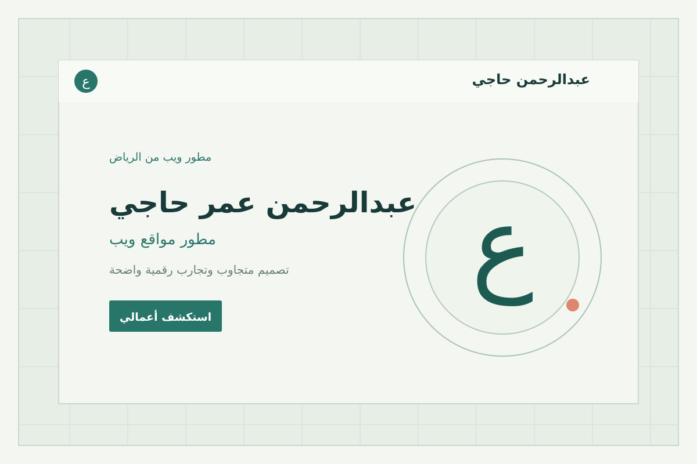

# البوابة الرقمية للأعمال والإنجازات

بوابة رقمية تجمع أعمال ومشاريع الويب في مكان واحد، وتتيح استعراضها بطريقتين: معرض المشاريع والعرض التقديمي التفاعلي.

## الأقسام الرئيسية

1. **المشاريع الرقمية:** `المعرض/projects.html` — استعراض المشاريع وروابط فتح كل مشروع.
2. **العرض التقديمي:** `presentation/index.html` — عرض تفاعلي بالشرائح وفهرس للوصول إلى المشاريع.

## معرض صور المشاريع

الصور التالية معاينات للمشاريع المرفقة في هذا المستودع. اضغط على اسم المشروع أو انتقل إلى صفحة المشاريع لمشاهدة تفاصيله.

| المشروع | المعاينة |
|---|---|
| عيادة الأسنان |  |
| السيرة الذاتية الرقمية |  |
| المقهى |  |
| مركز اللياقة |  |
| صيانة السيارات |  |
| الخدمات القانونية |  |

## التشغيل محليًا

افتح ملف `index.html` الموجود في المجلد الرئيسي، ثم اختر القسم الذي تريد استعراضه.

## النشر على GitHub Pages أو Cloudflare Pages

ارفع محتويات المجلد الرئيسي إلى جذر المستودع أو مجلد النشر، بحيث يكون ملف `index.html` في الجذر. لا يلزم أمر بناء (Build command).

## بنية الملفات

- `index.html`: الصفحة الرئيسية للبوابة.
- `المعرض/`: صفحات معرض الأعمال وقائمة المشاريع وملفاتها.
- `presentation/`: ملفات العرض التقديمي التفاعلي وصور معاينات المشاريع.
- `مشروع-ويب-01` إلى `مشروع-ويب-06`: مجلدات المشاريع المستقلة.

## قبل النشر

تحقق من بيانات التواصل التجريبية في العرض التقديمي، واستبدلها ببياناتك الصحيحة قبل مشاركة الموقع علنًا.
